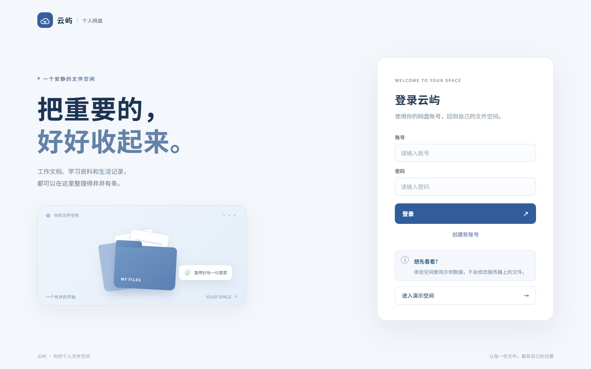
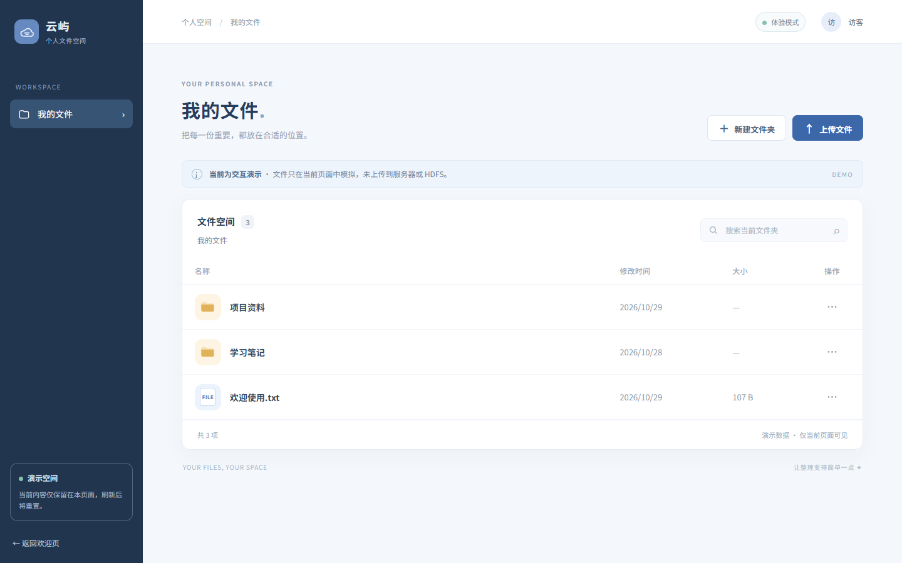
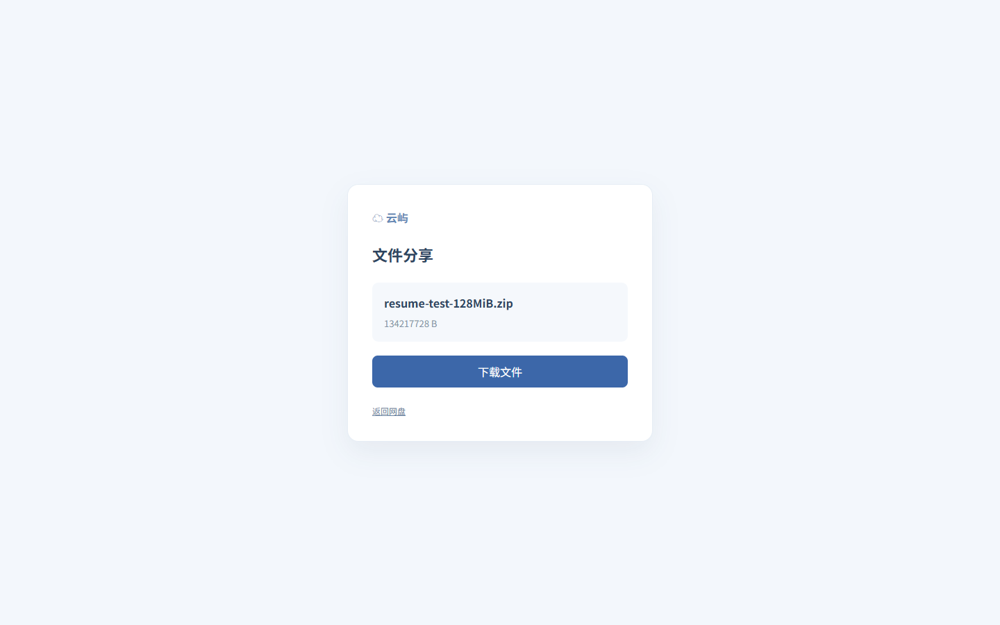
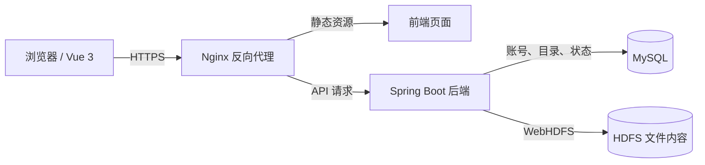

# 云屿 · HDFS 网盘

云屿是一个面向个人文件管理的课程项目。浏览器提供文件与文件夹操作界面，Spring Boot 处理认证和业务，MySQL 保存账号与文件元数据，文件内容通过 WebHDFS 存入 HDFS。

> 本项目目前面向单机课程演示：单个后端进程、单节点 HDFS。它展示了文件管理与存储协作，并不代表多节点高可用或生产级网盘。

## 目录

- [界面预览](#界面预览)
- [功能](#功能)
- [系统架构](#系统架构)
- [技术栈](#技术栈)
- [快速开始](#快速开始)
- [手动部署](#手动部署)
- [测试与验收](#测试与验收)
- [目录结构与设计资料](#目录结构与设计资料)
- [边界与已知限制](#边界与已知限制)
- [常见问题](#常见问题)

## 界面预览

| 登录页面 | 文件空间 |
| :---: | :---: |
|  |  |

文件空间截图为**演示模式**，使用示例数据，不会修改服务器文件。以下分享访问截图来自实际测试：



## 功能

| 功能 | 已实现内容 |
| --- | --- |
| 账号 | 注册、登录、退出、修改密码 |
| 目录与文件 | 文件夹创建和多级浏览、上传下载、重命名、移动、批量移动与批量删除 |
| 浏览与搜索 | 当前目录搜索、分页、按名称、时间或大小排序，显示文件数量和已用空间 |
| 大文件传输 | 分片上传、查看进度、中断后继续、失败重试及 SHA-256 分片校验 |
| 冲突处理 | 同名上传可选择保留两份或跳过；重命名和移动会检查冲突 |
| 回收站 | 删除后暂存，支持恢复和不可撤销的彻底删除 |
| 文件预览 | 支持图片、文本与 PDF，受预览大小限制 |
| 文件分享 | 单文件分享支持提取码、有效期、访问次数限制、访问统计与取消分享 |

文件和文件夹共用目录名称空间；上传冲突不会静默覆盖同名文件。上传会按文件名后缀限制类型，但不检查文件内容是否恶意。用量展示不等同于持久化存储配额。

## 系统架构



文件节点与上传任务由数据库记录，文件内容由 HDFS 保存。由于数据库与 HDFS 不属于同一事务，上传发布、删除与清理依靠任务状态和重试机制协调。详细模型与初版和当前范围说明见 [项目设计](docs/design/uml/README.md)、[数据库设计](docs/design/database/database-design.md) 和 [分片上传说明](docs/design/api/multipart-implementation.md)。

## 技术栈

| 层次 | 技术 |
| --- | --- |
| 前端 | Vue 3、TypeScript、Vite |
| 后端 | Java 17、Spring Boot、Spring Security、MyBatis-Plus、Maven |
| 元数据 | MySQL 8.4 |
| 文件存储 | Hadoop HDFS 3.5、WebHDFS |
| 部署与测试 | Nginx、Docker Compose、Maven 测试与集成测试脚本 |

## 快速开始

仓库提供独立的单节点 Compose 课程环境，包含 MySQL、HDFS、后端和前端。需要 Linux、Docker Engine、Compose v2、OpenSSL、curl，及足够的磁盘、内存和网络资源。

```bash
git clone https://github.com/YYchainsAw/hdfs-netdisk.git
cd hdfs-netdisk/deploy
sudo bash start.sh
```

启动脚本默认使用 `netdisk-course` 项目名，并将入口绑定到 `127.0.0.1:18090`。此环境会创建独立服务、数据卷及 `deploy/secrets/`，**不会自动接管现有 MySQL、HDFS 或网盘数据**。首次构建依赖网络，可能耗时较长。

实际浏览器访问还需单独配置可信 HTTPS 反向代理；脚本不自动申请证书或配置宿主机 Nginx。正式运行环境使用 Secure Cookie，代理应覆盖客户端提供的转发头。请先阅读完整的 [Compose 部署说明](deploy/README.md)，了解配置、持久卷和停止方式。

> 验证边界：早期独立 Compose 环境记录了上传、下载与重启持久化；集成版冒烟测试使用预构建的后端和前端产物。最终版本 Dockerfile 尚未从干净缓存完成冷构建验收，不能据此声称所有新环境已复现通过。

## 手动部署

手动部署适合已有 Java、MySQL 与单节点 HDFS 的环境；与 Compose 的独立环境是两种不同方式。

### 环境要求

- Linux x86-64、Java 17；仓库提供 Maven Wrapper，首次构建需要下载依赖。
- Node.js：依 `frontend/package.json` 的 `engines` 使用 `^22.18.0` 或 `>=24.12.0`；现有 CI 使用 Node.js 24.15.0。
- MySQL 8.4（脚本要求 8.0.17+）、InnoDB 与 `utf8mb4_0900` 排序规则。
- Hadoop 3.5 单节点 HDFS 与 WebHDFS。后端默认从本机访问 NameNode 的 `127.0.0.1:9870` 和 DataNode 的 `127.0.0.1:9864`，并校验重定向目标。
- 浏览器正式访问需要 HTTPS 及正确配置的反向代理；`server` profile 的 Cookie 带有 Secure 属性。

<details>
<summary>展开数据库、HDFS、构建与服务配置步骤</summary>

### 准备数据库

下面的五个 SQL 文件仅适用于**新建的空 `netdisk` 数据库**。脚本包括非事务性 DDL，按顺序各执行一次；不要对已有表或已有上传记录盲目重复执行。已有部署应先核对实际表、字段和索引状态，再决定迁移步骤。

1. 在本机 MySQL 创建 `netdisk` 空数据库，并为网盘创建专用账号。创建表和迁移使用有 DDL 权限的管理员；应用运行时只授予 `netdisk.*` 所需的 `SELECT`、`INSERT`、`UPDATE` 和 `DELETE` 权限。MySQL 容器与宿主机连接的客户端来源地址可能不是 `localhost`，账号 Host 必须与实际来源匹配。
2. 在仓库根目录，用有 DDL 权限的账号依次执行（`-p` 在终端交互读取管理员密码）：

   ```bash
   mysql -u <管理员用户名> -p netdisk < docs/design/database/schema.sql
   mysql -u <管理员用户名> -p netdisk < docs/design/api/migration-upload.sql
   mysql -u <管理员用户名> -p netdisk < docs/design/api/multipart-schema.sql
   mysql -u <管理员用户名> -p netdisk < docs/design/api/trash-schema.sql
   mysql -u <管理员用户名> -p netdisk < docs/design/api/share-schema.sql
   ```

   示例中的尖括号应替换，不能作为命令原样输入。`migration-upload.sql` 要求基础建表后 `nd_upload` 尚无数据；现有数据库不应将其当成幂等脚本重跑。
3. 应用账号密码由 `server` profile 读取服务器外部文件 `/etc/netdisk/secrets/spring.datasource.password`，文件名是 Spring 属性名。根据实际运行用户设置目录与文件的只读权限，密码不应放进 Git、镜像、命令行参数或日志。

`backend/src/main/resources/application-server.yaml` 默认连接 `jdbc:mysql://127.0.0.1:13306/netdisk`，账号为 `netdisk_app`；可用 `NETDISK_DB_URL` 和 `NETDISK_DB_USERNAME` 覆盖。连接串的 MySQL 时区需与数据库会话配置一致。数据库密钥目录不可读、账号 Host 不匹配或权限不足时后端可能启动失败。

### 准备 HDFS

按 [Hadoop 单节点部署文档](https://hadoop.apache.org/docs/current/hadoop-project-dist/hadoop-common/SingleCluster.html) 安装并配置 NameNode、DataNode 和 WebHDFS，确保后端进程通过环回地址访问 NameNode 和 DataNode，且 DataNode 返回的 WebHDFS 重定向地址可由后端访问。**不要把 HDFS 和 MySQL 端口直接暴露到公网。**

当前客户端通过本机 WebHDFS 的 `user.name=hdfs` 访问 `/netdisk/temp`、`/netdisk/users`；应以 HDFS 管理员创建这些目录并设置最小必要访问权限。该部署依赖本机网络隔离和 HDFS 简单认证边界，不应将这一 HTTP 接口暴露给不可信客户端。示例检查：

```bash
export JAVA_HOME=/usr/lib/jvm/java-17-openjdk-amd64  # 依机器调整
sudo -u hdfs env JAVA_HOME="$JAVA_HOME" /opt/hadoop/bin/hdfs dfs -ls -d /netdisk /netdisk/temp /netdisk/users
curl --fail --silent --show-error 'http://127.0.0.1:9870/webhdfs/v1/netdisk/temp?user.name=hdfs&op=GETFILESTATUS'
```

必须对新建集群初始化 NameNode；已有 HDFS 不能重复格式化。NameNode 元数据、DataNode 数据与 MySQL 元数据共同决定文件可用性。默认单个 DataNode、一个副本不提供高可用性。

### 构建与启动

以下命令以当前仓库版本及已完成前述依赖配置为前提。命令不会配置 HTTPS 或管理系统服务。

```bash
# 在仓库根目录
cd backend
./mvnw --batch-mode --no-transfer-progress test
./mvnw --batch-mode --no-transfer-progress package
java -jar target/backend-0.0.1-SNAPSHOT.jar --spring.profiles.active=server
```

`server` profile 默认仅监听 `127.0.0.1:18084`，进程须能读取外部数据库密钥。上传/清理使用 `/run/lock/netdisk-multipart.lock`：同一数据库与 HDFS 路径只能由**一个**受该锁保护的后端实例访问，不得通过其他 profile 或不同主机绕过。更多状态和清理规则见 [分片上传实现说明](docs/design/api/multipart-implementation.md)。

新开终端构建前端：

```bash
cd frontend
npm ci
npm run build
```

将 Nginx 站点根目录指向 `frontend/dist`，将 `/api/` 代理到 `http://127.0.0.1:18084`，并为路由提供 `index.html` 回退。反向代理必须覆盖外来 `Forwarded` 和 `X-Forwarded-*` 头并根据实际协议、主机与端口设置可信值；后端只接受本机代理访问。单个分片为 8 MiB，代理请求体限制需允许该大小，合并 2 GiB 文件时也需足够的代理读取超时。TLS 证书申请、端口和站点配置须按实际环境完成并经过 `nginx -t` 检查。

当前服务器使用 `netdisk-backend.service` 与 `netdisk-hdfs-{namenode,datanode,secondarynamenode}.service`；这些 systemd 单元尚未随仓库提供，不能把该名称当成新机器自动存在。当前后端监听端口为 18084，MySQL 宿主机映射端口 13306；换机器请检查端口冲突并按需调整配置。

### 账号与演示

系统支持注册，注册成功后使用本人设置的账号密码登录；仓库没有默认密码或演示账号。账号名需为 3–64 位英文字母、数字、`.`、`_`、`-`，密码至少 12 个字符且 UTF-8 不超过 72 字节。也可用交互式 CLI 创建账号，参见 [账号创建说明](backend/docs/CREATE_ACCOUNT.md)；账号创建工具在本机交互式终端运行，不需要停止网盘服务。不要将真实账号凭据写入说明或截图。

Vite 可用于本机调试：`cd frontend && npm run dev`，默认 `/api` 代理到 `127.0.0.1:18084`。`localdev` profile 关闭 Secure Cookie，必须限定为本机调试，不能向公网暴露；正式部署只使用 HTTPS。


</details>

## 测试与验收

```bash
# 后端常规测试
cd backend
./mvnw --batch-mode --no-transfer-progress test

# 回到仓库根目录，再执行前端类型检查与生产构建
cd ../frontend
npm ci
npm run build
```

后端常规测试使用 H2，依赖真实 MySQL 的测试可能默认跳过，不能视为已经覆盖实际 HDFS。各类独立测试的资源条件、测试范围与清理方式见 [backend/qa](backend/qa/)，其中包括 [上传集成测试](backend/qa/integration-qa/README.md)、[分享测试](backend/qa/share-qa/README.md) 和 [可靠性与安全性记录](backend/qa/VERIFICATION-20261123.md)。

项目曾在服务器现有部署中使用 **128 MiB** 文件演示浏览器离线后继续上传；原文件、个人下载和分享下载的 SHA-256 一致。这是一次样本，并不代表所有文件大小、网络条件或长期并发均已验证。早期版本的 [2 GiB 性能记录](backend/qa/performance-qa/results-20261123.md) 需按记录中的代码版本、设备和单次测试条件解释。

## 目录结构与设计资料

```text
backend/                 Spring Boot 后端与 Maven Wrapper
backend/qa/              集成、可靠性、安全性及性能测试
frontend/                Vue 前端
  src/                   页面、组件与交互
  public/                前端静态资源
deploy/                  独立 Compose 环境与部署说明
docs/design/api/         接口、迁移脚本及上传设计
docs/design/database/    数据库设计与建表脚本
docs/design/uml/         draw.io 图源及 PNG
docs/screenshots/        README 界面截图
.github/workflows/       自动化检查
```

- [用例图](docs/design/uml/png/netdisk-use-case.png) · [设计类图](docs/design/uml/png/netdisk-class.png) · [数据库关系图](docs/design/uml/png/netdisk-database-erd.png) · [上传冲突流程图](docs/design/uml/png/upload-conflict-flow.png)
- [接口设计草案](docs/design/api/api-design.md) · [数据库设计](docs/design/database/database-design.md) · [回收站说明](docs/design/api/trash-design.md)

设计资料可能包含初期规划；类图和关系图只展示主要类或部分关系，具体功能与约束以当前代码和数据库迁移脚本为准。

## 边界与已知限制

- 单个后端进程、单节点 HDFS；不提供多节点高可用，也没有验证过的独立备份与恢复演练。
- 单文件默认上限 **2 GiB**、分片 **8 MiB**。当前每个账号最多 2 个活跃上传任务、共 2 GiB；全局最多 4 个活跃任务、共 4 GiB。合并与临时分片需要额外磁盘空间。
- 未实现持久化用户存储配额、文件历史版本或恶意文件内容扫描。预览和下载等接口需要鉴权；文件分享只针对单个文件。
- 登录限速保存在单个后端进程内，重启后清零；注册不含邮箱验证或验证码，不应将其等同于分布式攻击防护。
- 最终版干净 Compose 冷构建、恶意文件内容检测和完整的分享链接抗枚举能力仍需进一步验证。

## 常见问题

- **登录后仍显示未登录**：检查 HTTPS、Cookie、系统时间以及可信反向代理转发头；`server` profile 要求 Secure Cookie。
- **上传失败或接口返回 503**：确认 MySQL、HDFS、WebHDFS 访问、磁盘空间、目录权限及后端日志。
- **提示同名或并发冲突**：刷新后按提示处理；上传同名时可选择保留两份或跳过。
- **上传任务或空间达到上限**：检查活跃任务和 HDFS 空间；空间检查预留 10 GiB，且不能阻止同盘其他服务占用空间。
- **端口或锁冲突**：检查后端端口和现有实例；不要通过更换配置绕过单实例锁。

## 项目说明

本项目用于大数据存储课程实践。请在公开分享仓库、截图和日志前移除真实密码、密钥、数据库连接凭据及分享令牌。

## 开源协议

本项目采用 [MIT License](LICENSE)。
